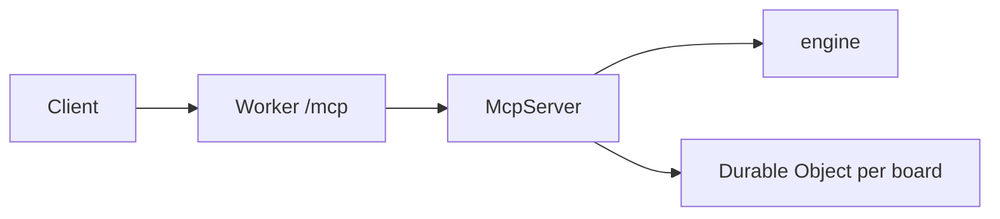

# Architecture

`board-clerk` 0.3.0 is a Streamable HTTP MCP server. The engine is rule-based. It does not call a model. Per-board state is a SQLite Durable Object. Tests without a binding use `MemoryStore`, which speaks the same `POST /op` JSON.

The tool handler calls the engine for rules and the Durable Object for stored meetings, confirmations, approvals, and the audit log. The engine does not open the Durable Object itself.

The client is MCP Inspector, or the `/demo` page, which posts JSON-RPC to `/mcp`. The Worker allows `GET /`, `GET /health`, `GET /demo`, and `GET /demo/transcript.txt`. Any other path is 404. `@modelcontextprotocol/server` 2.3.1 `createMcpHandler` has no `route` option and answers on whatever path it is mounted, so `src/index.js` is the router. `/mcp` checks `Origin`, then reads at most 256 KB, then calls `McpServer`.

`McpServer` registers 16 tools, the `board://{board_id}/roster` and `board://{board_id}/meetings` resource templates, the static resource `ui://board-clerk/decision-card`, and the `ask_the_board` prompt. Tool code uses the engine (`extract`, `namerule`, `query`, `packet`, `minutes`, `validate`, and `crosscheck` when `ingest_meeting` receives `second_pass_motions`). `BoardState` is one Durable Object per `board_id`. Reads of `juniper-hollow-demo` layer fixture meetings under stored ones. Writes on that id return `isError`. `start_demo_board` copies those two fixtures onto any other id.

The decision card follows the MCP Apps field names from the 2026-01-26 ext-apps spec: URI `ui://…`, mime type `text/html;profile=mcp-app`, tool link `_meta.ui.resourceUri`, resource `_meta.ui.prefersBorder`. The HTML posts `ui/initialize` (with `appInfo` and `appCapabilities`) and then `ui/notifications/initialized`, and it renders `ui/notifications/tool-result`. Installed `@modelcontextprotocol/server` 2.3.1 has `registerResource` and tool `_meta`. It does not export `registerAppTool` or `registerAppResource`, and this server does not advertise `io.modelcontextprotocol/ui`. No MCP Apps host was run, so the iframe handshake is not verified. Clients that ignore UI still get the text line and `structuredContent`.
